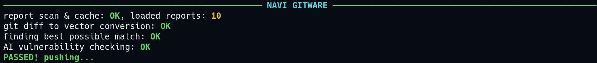

# NAVI GITWARE

<p align="left">
  
  
  
  
  
  
  
</p>

Automated local `pre-push` security gate powered by semantic code embeddings and local LLMs via Ollama. Ships out of the box with a built-in **OWASP Top 10:2025** PDF knowledge base, intercepts outgoing `git push` diffs, retrieves the closest matching vulnerability report from a SHA-256 cached index, enforces strict structured output via Pydantic v2, and blocks vulnerable commits with syntax-highlighted diagnostics in the terminal using `rich`.



---

## Architecture

```text
[Git Push Diff (@{u}..HEAD)]        [reports/*.pdf (OWASP 2025)]
              │                                    │
              ▼                                    ▼
       get_push_diff()                      update_cache()        --> Extracts PDF text (PyMuPDF) & SHA-256 caches vectors
              │                                    │
              ▼                                    │
       get_embedding()                             │              --> Encodes diff via jina-embeddings-v2-base-code
              │                                    │
              └─────────────────┬──────────────────┘
                                ▼
                         vector_compare()                         --> Dot-product similarity search for best report match
                                │
                                ▼
                         check_git_diff()                         --> Ollama inference (qwen3.5:4b, temp=0.1, JSON schema)
                                │
                                ▼
                     SecurityReview (Pydantic)                    --> Validates boolean verdict, reason, file & snippet
                                │
                                ▼
                        Rich Terminal Gate                        --> Allows push (exit 0) or blocks with red Panel (exit 1)
```

---

## Built-in Knowledge Base (OWASP Top 10:2025)

Ready to run out of the box — `reports/` comes pre-populated with 10 single-page security advisories aligned with **OWASP Top 10:2025**, containing vulnerability descriptions, diff patterns, vulnerable/secure code snippets, and remediation checklists:

| File | Category | Coverage |
| :--- | :--- | :--- |
| `A01_2025_Broken_Access_Control_and_SSRF.pdf` | `A01:2025` | IDOR, missing function-level access control, SSRF |
| `A02_2025_Security_Misconfiguration.pdf` | `A02:2025` | Production debug flags, wildcard CORS, default credentials |
| `A03_2025_Software_Supply_Chain_Failures.pdf` | `A03:2025` | Unpinned packages, mutable base images, CI/CD integrity |
| `A04_2025_Cryptographic_Failures.pdf` | `A04:2025` | Hardcoded secrets, MD5/SHA-1 hashing, disabled TLS checks |
| `A05_2025_Injection_SQLi_XSS_CMDi.pdf` | `A05:2025` | SQL injection, OS command injection (`shell=True`), XSS |
| `A06_2025_Insecure_Design.pdf` | `A06:2025` | Client-trusted pricing, missing rate limits, trust boundary flaws |
| `A07_2025_Authentication_Failures.pdf` | `A07:2025` | Unverified JWT signatures, insecure session cookies |
| `A08_2025_Software_Data_Integrity_Failures.pdf` | `A08:2025` | Unsafe `pickle`/`yaml.load()` deserialization, missing HMAC/SRI |
| `A09_2025_Logging_and_Alerting_Failures.pdf` | `A09:2025` | Credential/header leakage in logs, CRLF injection, silent auth failures |
| `A10_2025_Mishandling_Exceptional_Conditions.pdf` | `A10:2025` | Fail-open authorization, non-atomic state mutations, swallowed errors |

You can drop additional custom `.pdf` advisories into `reports/` at any time — `update_cache()` automatically indexes new or modified files via SHA-256 hashing.

---

## Security Pipeline & Models

Every `git push` triggers a four-stage deterministic verification flow:

| Component | Implementation | Role |
| :--- | :--- | :--- |
| **Diff Extractor** | `git diff @{u}..HEAD` (fallback: `origin/main..HEAD`) | Captures outgoing changes prior to remote transfer |
| **Report Cache** | `SHA-256` + `PyMuPDF` + `reports_cache.json` | Incremental indexing of `reports/*.pdf` without re-embedding unchanged files |
| **Semantic Retriever** | `jinaai/jina-embeddings-v2-base-code` (`FastEmbed`) | Maps code diffs and vulnerability reports into a shared vector space |
| **Code Auditor** | `qwen3.5:4b` (`Ollama`, `temperature=0.1`, `think=False`) | Evaluates whether the diff introduces or repeats the matched vulnerability |

---

## Installation

### 1. Python Dependencies

```bash
pip install ollama pymupdf fastembed pydantic rich
```

### 2. Local LLM Setup

Ensure [Ollama](https://ollama.com/) is installed and pull the audit model:

```bash
ollama pull qwen3.5:4b
```

*(Note: `jinaai/jina-embeddings-v2-base-code` is downloaded automatically by `fastembed` on first execution.)*

---

## Execution & Git Hook Setup

### 1. Wire as a `pre-push` Hook
Link `src/pre_push.py` into `.git/hooks/pre-push` and make it executable (the OWASP Top 10:2025 reports in `reports/` work out of the box):

```bash
cat << 'EOF' > .git/hooks/pre-push
#!/usr/bin/env bash
python3 src/pre_push.py
EOF
chmod +x .git/hooks/pre-push
```

### 2. Gate Behavior
- **Empty diff / missing `reports/`:** Prints status notice and exits with `0` (push proceeds).
- **Safe diff (`vulnerable: false`):** Prints `PASSED! pushing...` and exits with `0`.
- **Vulnerability detected (`vulnerable: true`):** Renders a `PUSH BLOCKED` `rich.panel.Panel` containing the matched report filename, root cause, target file, and `monokai` syntax-highlighted offending code snippet, then exits with `1`.

---

## Validation Contract (Pydantic v2)

LLM responses are constrained via `format=SecurityReview.model_json_schema()` (`temperature=0.1`) and validated against `SecurityReview` to return strictly:

```json
{
  "vulnerable": true,
  "reason": "string (one short sentence explaining why, or 'PASS' if safe)",
  "file": "string (vulnerable file path without 'b/' prefix, or empty string if safe)",
  "snippet": "string (exact vulnerable line/snippet without leading '+', or empty string if safe)"
}
```

---

## Project Structure

```text
├── reports/
│   ├── A01_2025_Broken_Access_Control_and_SSRF.pdf
│   ├── A02_2025_Security_Misconfiguration.pdf
│   ├── A03_2025_Software_Supply_Chain_Failures.pdf
│   ├── A04_2025_Cryptographic_Failures.pdf
│   ├── A05_2025_Injection_SQLi_XSS_CMDi.pdf
│   ├── A06_2025_Insecure_Design.pdf
│   ├── A07_2025_Authentication_Failures.pdf
│   ├── A08_2025_Software_Data_Integrity_Failures.pdf
│   ├── A09_2025_Logging_and_Alerting_Failures.pdf
│   └── A10_2025_Mishandling_Exceptional_Conditions.pdf
├── src/
│   ├── logic.py             # Git diff subprocess, PDF parser, SHA-256 vector cache, Ollama audit
│   └── pre_push.py          # Git pre-push entrypoint, pipeline orchestration, Rich UI panels
├── .gitignore
├── LICENSE
├── README.md
└── reports_cache.json       # Auto-generated SHA-256 indexed text & embedding cache
```

---

## License

MIT